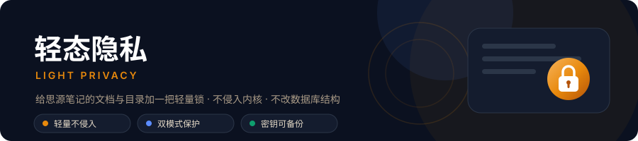
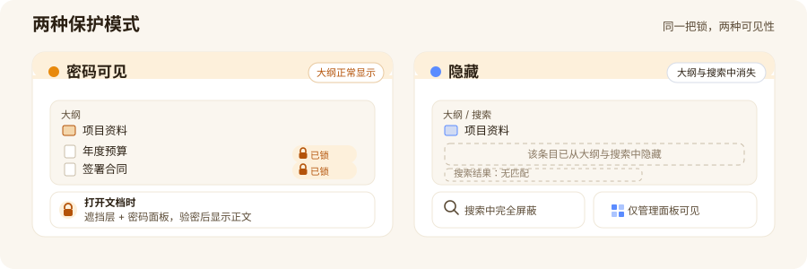
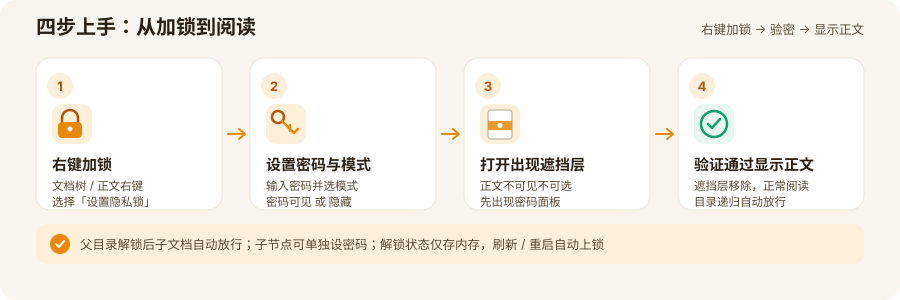
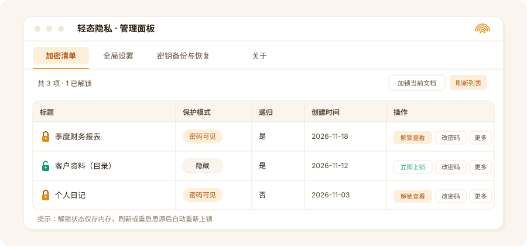
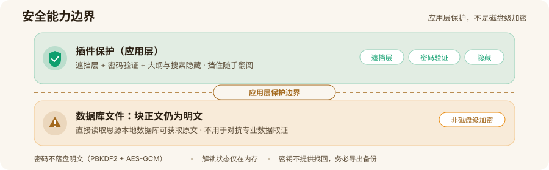

# 轻态隐私（Light Privacy）



给思源文档与目录加一把轻量锁——不侵入内核，不改数据库结构。（包名 `siyuan-light-privacy` · v0.4.0 · 适配思源 3.x · 零第三方依赖）

## 3 分钟看懂

- **是什么**：思源笔记前端插件，给指定文档/目录加密码锁，支持"密码可见"和"隐藏"两种模式；零依赖、不侵入内核、不改数据库结构。
- **给谁用**：笔记里有不想被家人/同事随手翻到、或演示时误点开的内容的用户；要的是轻量遮挡，不是对抗专业取证。
- **解决什么**：共享设备/屏幕时隐私暴露——锁住打开入口、把隐藏条目从大纲和搜索抹掉，刷新/关标签页/闲置后自动重新上锁。

> 一句话定位：**轻量锁住思源文档与目录，挡住随手翻阅，不改你的笔记数据。**

## 它能做什么



两种保护模式：密码可见只拦打开，隐藏连大纲和搜索都看不到。目录支持递归保护（父目录解锁后子文档自动放行，子节点仍可独立设密码）。

## 快速开始（3 步）

1. 定位思源数据目录：设置 → 关于 → 基本信息 → 数据文件夹。
2. 把插件包全部文件复制到 `data/plugins/siyuan-light-privacy/`（至少包含 `plugin.json`、`index.js`、`index.css`、`icon.png`、`i18n/`）。
3. 重启思源，在 设置 → 集市 → 已下载 中启用「轻态隐私」。启用后右上角出现指纹图标即成功。

## 使用指南

### 加锁与打开



四步上手：右键加锁 → 设置密码与模式 → 打开出现遮挡层 → 验证通过显示正文；父目录解锁后子文档自动放行。

右键文档树节点或正文 → "设置隐私锁" → 输入密码、选择模式；打开受保护文档时先遮挡验密，未通过时正文不可见、不可选中。

### 管理面板



右上角指纹图标打开管理面板：加密清单 / 全局设置 / 密钥备份与恢复 / 关于。

| Tab | 功能 |
| --- | --- |
| 加密清单 | 查看全部条目；解锁查看、改密码、切换模式、取消加密、导出单条密钥、临时显示到大纲、清理失效记录 |
| 全局设置 | 全局管理主密码、隐藏条目在搜索中屏蔽、回收站自动解锁、关闭标签页自动上锁、闲置自动上锁、主题三态、高级模式（实验性预留） |
| 密钥备份与恢复 | 导出全部密钥包（文本 + 一键复制）、导入备份 |
| 关于 | 版本与适配、一句话定位、安全边界与前往备份入口 |

### 主密码与密钥备份

> **风险提示**：全局管理主密码保护面板入口；首次加锁后务必导出备份；密钥 / 全局管理主密码 / 备份密码丢失均无法找回。

- 开启全局管理主密码后，进入加密清单必须先验证主密码。
- 备份包使用你设置的备份密码做 AES-GCM 加密，插件不上传任何数据。

## 自动上锁规则

解锁状态只在当前会话内存中保存。满足以下任一条件即重新上锁，下次访问需再次验密：

- 刷新思源页面或重启思源；
- 禁用 / 卸载插件；
- 在管理面板对已解锁条目点击「立即上锁」；
- 取消加密后重新加锁、导入密钥备份；
- **关闭标签页自动上锁**（默认开启）：关闭某文档的标签页后，若没有其他标签页打开同一文档，则清除该文档解锁状态；
- **闲置自动上锁**（默认开启，默认 10 分钟）：鼠标、键盘、滚轮、触摸均无操作超过设定时长后，自动清除全部解锁状态（1 - 120 分钟可调）。

## 安全边界（必读）



保护的是随手翻阅，不是磁盘文件：默认块正文仍明文存于本地数据库。

> 轻态隐私是**应用层隐私保护**，不是磁盘级或密码学级强加密：
>
> 1. 默认模式下块内容仍以明文存于思源本地数据库，直接读取数据库文件可获取原文；
> 2. 定位于"防家人 / 同事随手翻阅、防演示误点开"，不用于对抗专业数据取证；
> 3. 密码不以明文落盘，仅存 PBKDF2-SHA256 校验值与被密码派生密钥包裹的内容密钥；`data.json` 的敏感载荷另有 AES-GCM 加密层；
> 4. 解锁状态仅存内存，刷新页面或重启思源后自动失效。

V0.5 块正文密文写回：实验性预留，默认不写回任何块内容。

## 开发者与构建

### 源码与构建

源码位于 `src/`，`build.js` 将 CommonJS 模块内联打包为根目录 `index.js`，并把 `assets/style.css` 复制为 `index.css`，无需安装任何依赖。

```bash
node build.js
node --check index.js
```

修改源码后必须重新执行 `node build.js`，再在思源中禁用 / 启用插件（或重启思源）加载新版本。

### 模块说明

| 文件 | 职责 |
| --- | --- |
| `src/crypto.js` | PBKDF2 派生、AES-GCM 加解密、哈希校验、随机数 |
| `src/store.js` | `data.json` 存储、lockList 增删改查、全局配置、密钥备份 |
| `src/hookAdapter.js` | 思源 eventBus / DOM 观察适配层，钩子失效时降级 |
| `src/hook.js` | 文档遮挡拦截、隐藏节点样式、搜索过滤、目录递归校验 |
| `src/contextMenu.js` | 大纲与正文右键菜单 |
| `src/modal.js` | 密码弹窗、二次确认、备份文本弹窗 |
| `src/panel.js` | 管理面板四个 Tab |
| `src/index.js` | 插件入口与生命周期 |

### 开发者 API（已暴露）

以下四个 API 已在 `siyuan.plugins.lightPrivacy` 上实际挂载，可用于查询锁定状态与订阅锁定 / 解锁事件：

```js
siyuan.plugins.lightPrivacy.isLocked(blockId)
siyuan.plugins.lightPrivacy.getLockInfo(blockId)
siyuan.plugins.lightPrivacy.onUnlocked(cb)
siyuan.plugins.lightPrivacy.onLocked(cb)
```
